# OpenMixer plugin panels on Zynthian

An OpenMixer plugin (the `omx-*` CLAP and LV2 plugins of omx-plugins) runs on Zynthian in plugin-hostd, the `PH/`
engine of this fork. Its controls reach the screen in one of two ways:

- **Controller pages.** Every plugin. omx-panel cuts the plugin's controls into pages of four, one page per screen,
  and the control screen lists the pages on the left (V4) or fills the screen with the list (V5) and puts the page's
  four controls on the knobs. The page sequence is omx-panel's one cut (`omx-panel describe --pages --per-page 4`,
  docs/panel-layout.md there): the Easy controls first, then the plugin's own pages, a group kept whole. When
  plugin-hostd runs the plugin, the pages are the ones the plugin declares (CLAP remote-controls), cut again at four.
- **The panel screen.** A plugin whose panel has a curve, a meter or a bar group also gets
  `zyngui/zynthian_widget_omx_panel.py` in the list's place: omx-panel's renderer
  (`libomx-panel-render.so.1`) draws the sections of the page's controls with their values, the curve's section above
  them on every page (plugin-hostd computes the curve from the plugin's values: `curve_bind`, `curve_points`), and the
  meters. omx-comp, omx-eq8, omx-geq, omx-multiband, omx-delay and omx-reverb have one; omx-strip has none and shows
  the controller pages alone.

A page is named by the labels the panel declares: `Gate`, `Gate 2/3`, `EQ: EQ 1`, `Bands: Band 1 – Band 2`. A
controller's title is its label and its unit's symbol as the contract writes it (`Trim dB`, `HPF Slope dB/oct`,
`Comp Mix %`); a control with no unit shows no unit.

## How the pictures are made

`tools/panel_screens.py` builds the UI's own control screen (`zyngui/zynthian_gui_control.py`, its four
controllers, the panel screen) on a Tk display of the Zynthian's size, adds each plugin to a real plugin-hostd
through this tree's engine, and takes every page the screen lists from the X display. Only the UI object is a
stand-in. The pictures here were taken in a debian trixie container (Xvfb, jackd on the dummy driver,
plugin-hostd 0.22.4, omx-clap-host 0.36.0, omx-panel 0.17.3, omx-plugins 0.22.4) at 480x320
(`ZYNTHIAN_WIRING_LAYOUT=V4`) and 800x480 (`V5`), with the stock look unless said; the renderer is loaded by its
default name. The run is described at the top of the tool.

## omx-strip, the channel strip, page by page

omx-strip is the console's channel strip in one plugin: input, filters, gate, a parametric EQ of up to 32 bands
(four shown at start, `EQ Bands`), compressor, and the order of the blocks. It has the most control groups of the
omx plugins. It has no curve or meter, so Zynthian shows it as controller pages. The page list, at 480x320:

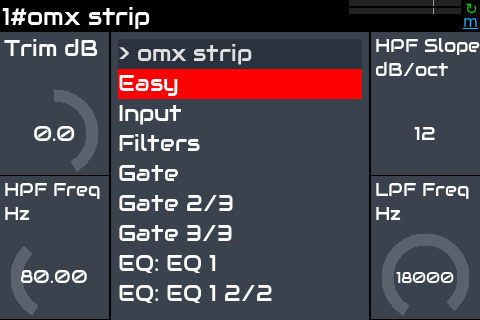

| Page | The four controls | What the group does |
|---|---|---|
| Easy | Trim dB, HPF Freq Hz, HPF Slope dB/oct, LPF Freq Hz | The controls a quick setup needs, as the plugin declares its Easy page: the input trim, the high-pass frequency and slope, the low-pass frequency. |
| Input | Input | The input stage on or off (its trim is on the Easy page). |
| Filters | Filters, HPF, LPF, LPF Slope dB/oct | The high-pass and low-pass filters: the block on, each filter on, the low-pass slope. |
| Gate, Gate 2/3, Gate 3/3 | Gate, Threshold dB, Ratio, Range dB; Attack ms, Release ms, Knee Start dB, Knee End dB; Hold ms, Hysteresis dB | The noise gate: on, where it opens, how hard and how far it closes, how fast, its soft knee, how long it holds open and the gap between opening and closing. |
| EQ: EQ 1, EQ: EQ 1 2/2 | EQ, EQ Bands, EQ 1 Type, EQ 1 Freq Hz; EQ 1 Gain dB, EQ 1 Q, EQ 1 | The EQ on, how many bands it has, then band 1: its shape (low shelf, bell, high shelf...), frequency, gain, width, on. |
| EQ: EQ 2 ... EQ: EQ 4 2/2 | Type, Freq Hz, Gain dB, Q; on | Bands 2 to 4, the same five controls each. A band past `EQ Bands` has no page. |
| Comp, Comp 2/3, Comp 3/3 | Comp, Threshold dB, Ratio, Knee dB; Attack ms, Release ms, Makeup dB, Kind; Mix %, Detector Oversampling | The compressor: on, where and how hard it works, its knee, how fast, the gain it gives back, its kind, the dry/wet mix, the detector's oversampling (Auto, Off, 4x). Kind is Compressor or Limiter. |
| Order | Order | The order the five stages run in: 0 is the console's own, input > filters > gate > EQ > comp; 1 to 119 every other order (omx-plugins docs/omx-strip-modgui.md). |

| | |
|---|---|
| 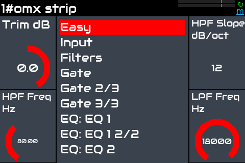 | 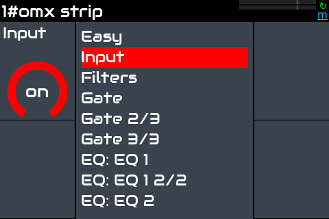 |
| 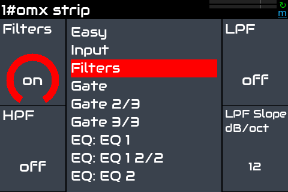 | 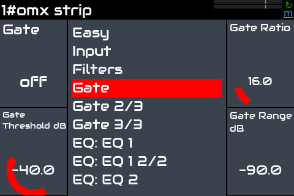 |
| 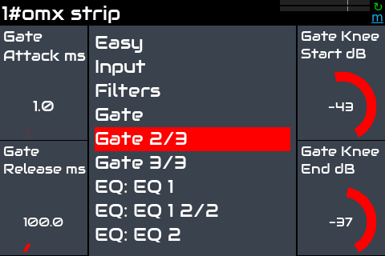 | 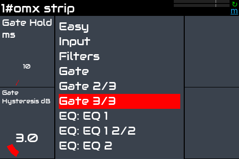 |
| 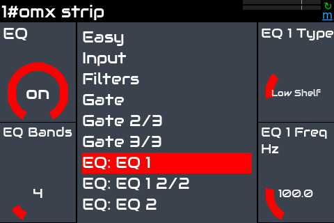 | 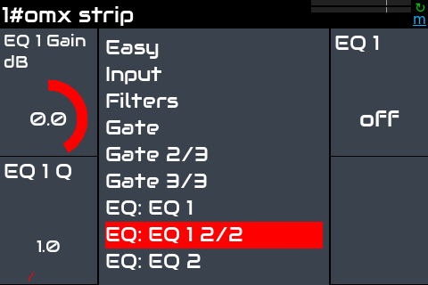 |
| 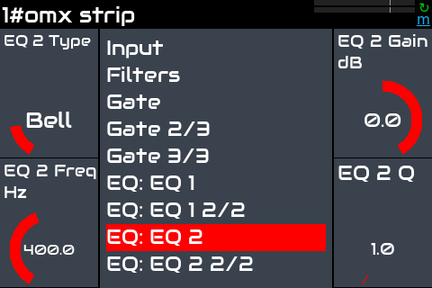 | 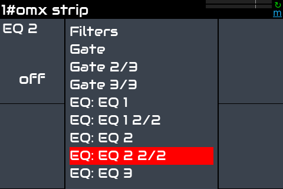 |
| 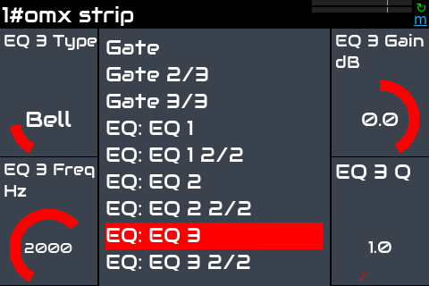 | 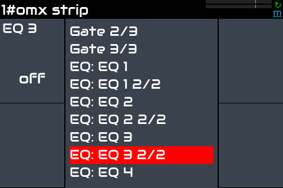 |
| 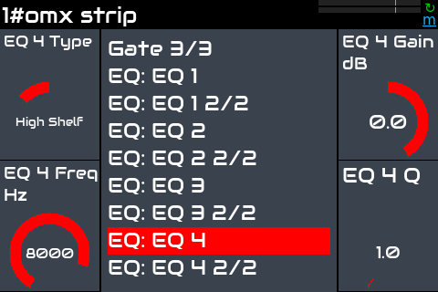 | 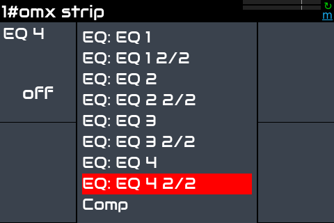 |
| 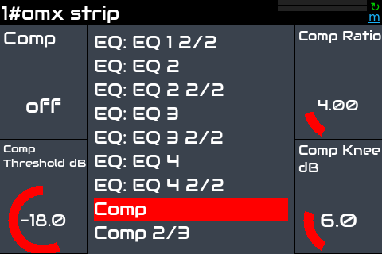 | 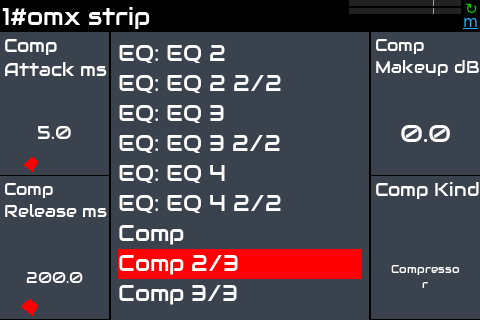 |
| 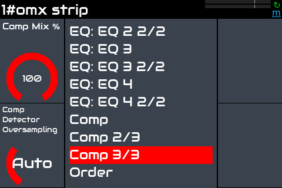 | 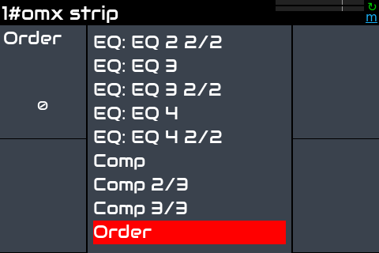 |

On the V5's 800x480 screen the list fills the left and the four controls stand on the right:

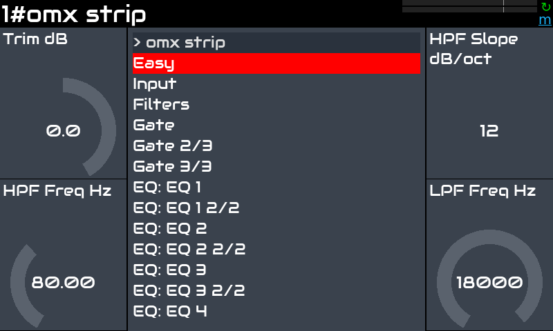
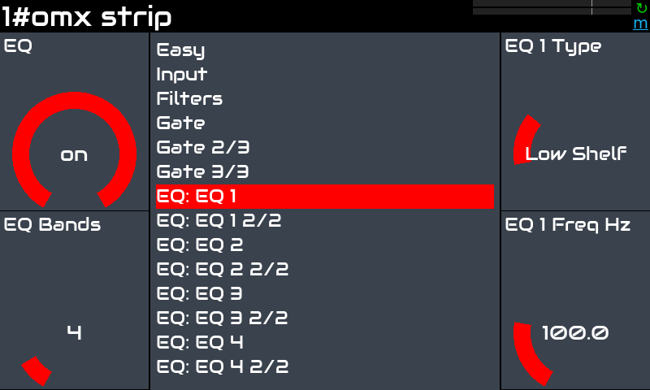

With the OpenMixer vintage look (`zynthian-sys config/ui-looks/openmixer-vintage.sh`) the controllers are drawn by
omx-panel's renderer:

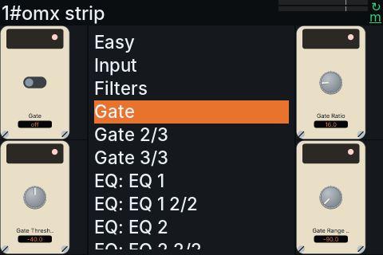

## The other control groups: curves, meters, bar groups

omx-strip shows switches, knobs and choices, but none of the panel's drawn groups. Those are on other plugins:

| Group | Plugin | Picture |
|---|---|---|
| a transfer curve, a gain-reduction bar and four meters | omx-comp | 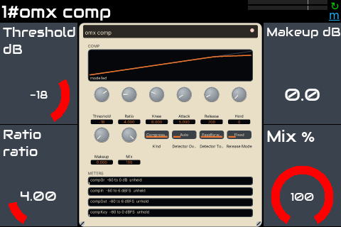 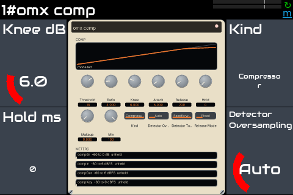 |
| the EQ's response curve | omx-eq8 | 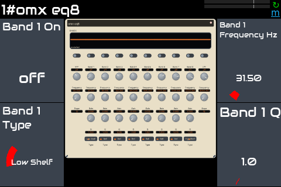 |
| a bar group (31 bands) | omx-geq | 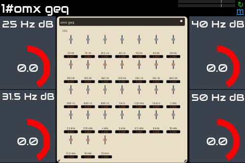 |
| a bar group (the crossovers), gain reduction and five meters | omx-multiband | 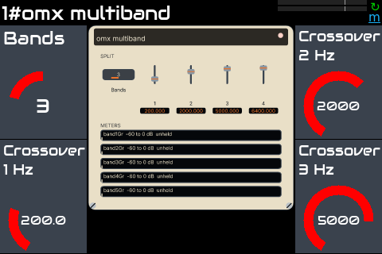 |
| a time response: a reverb's decay, a delay's taps | omx-reverb, omx-delay | 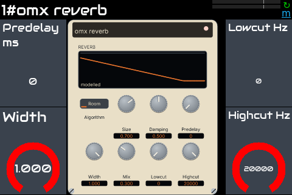 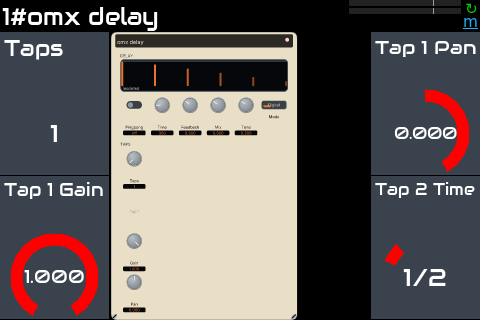 |

## What was fixed for these pictures

Taken first on 2026-11-28 with six faults, each fixed where it was caused and the pictures taken again:

- **The panel screen drew no value.** The renderer's layout names a CLAP control by its contract symbol
  (`thresholdDb`) and gives the parameter number in `param`; the panel screen keyed the engine's controllers as
  `p<number>`, so no control was bound. It joins them by `param` now (this fork, lane/omx-panel-join-by-param).
- **No curve was drawn.** The engine binds a curve by the description's symbols (`threshold=thresholdDb:dB`), and
  omx-clap-core's host took a CLAP parameter by its number only (-103); it takes the symbol the plugin's parameter
  contract keeps now (omx-clap-core lane/param-of-contract-symbol). And `curve_points` answers a marks word after
  the count, which this fork read as the first point (lane/omx-curve-points-marks).
- **omx-strip showed two Easy pages.** omx-panel derived one Easy page from the scanned descriptor and kept the one
  omx-strip declares; the plugin's declared Easy page is the one Easy page now (omx-panel
  lane/easy-from-declared-page, docs/panel-layout.md there).
- **This fork loaded `libomx-panel-render.so.0`**, which omx-panel 0.17 does not ship: a device drew no panel
  screen. It loads `.so.1` (lane/zynthian-ui-47-rta-dual-trace-so1, #51), and these pictures set no override.
- **omx-eq8's response curve was an empty frame.** Its description gives the head filters' slope roles the unit
  `dBPerOct` (`hpf_slope=hpf_slope:dBPerOct`), the PARAM_UNITS id of the parameter, and omx-dsp's curve had no such
  unit, so plugin-hostd refused the binding (-538, reply.plugin-hostd.curve-unit-refused). omx-dsp reads a head
  filter's slope in `dBPerOct` now (omx-dsp lane/curve-slope-unit-word); the omx-eq8 pictures were taken with
  plugin-hostd's protocol library rebuilt over it.
- **omx-delay's taps were not drawn.** Its `time_response` answers no point, only the taps after the count
  (`stems ...`), and this fork read past them. The panel gives them to the renderer now
  (`omx_panel_view_set_stems`, this fork, lane/omx-delay-taps), each with its leg's letter.

## What these pictures still show wrong

- **`Ratio ratio`.** The contract's symbol for the unit `ratio` (omx-contract-data's param domain, PARAM_UNITS
  `ratio`, `x-symbol` "ratio") is the word itself; the contract declares no `:1` form, so the title shows the word.
