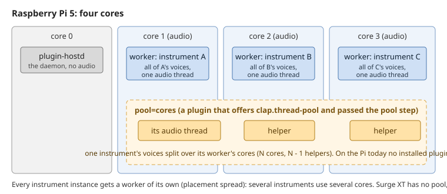

# Instruments and the Pi's cores: one worker each, and the thread pool

How the plugin-hostd engine spreads instruments over a Raspberry Pi 5's four cores, what the CLAP
thread pool would add inside one instrument, and what Surge XT does today.

## One worker per instrument

- plugin-hostd starts in placement `spread`: the daemon on core 0, every plugin instance in a worker
  process of its own, the workers on the audio cores 1-3 (its log says so at start: `placement spread:
  workers on the audio cores 1-3, the daemon on 0`).
- A worker runs its instance's audio on one real-time thread. Every voice of that instrument is rendered
  on that thread, one after the other, inside each JACK cycle.
- So several instruments use several cores, and one instrument uses one core, however many voices it plays.

## The thread pool, inside one instrument

- A CLAP plugin can offer the `clap.thread-pool` extension: it then asks the host to run part of its cycle
  (typically its voices) on helper threads, and waits for them before the cycle ends.
- The host grants it per plugin, from the plugin's qualification record: the record's pin says
  `pool=cores` (helpers on the worker's other cores) or `pool=off` (the plugin's own serial path). The
  record gets that pin from the qualification's pool step, which runs the plugin with and without the pool
  and keeps the pool only for a plugin that asks for it and stays real-time safe with it.
- The pool step is blocked today by a defect in plugin-hostd's pin handling (plugin-hostd#82); until it is
  fixed no record can carry `pool=cores`.
- **On the Pi today no installed plugin asks for the pool.** Every pool step of the Pi's qualification
  run (263) reads `not-asked`.

## Surge XT

- Surge XT's CLAP does not offer `clap.thread-pool` (its descriptor reports `threadPool: false`). It
  renders its voices serially on its worker's thread, with or without a pin; there is nothing for the
  pool to change. More Surge XT instances, each with its own worker, are what use more cores.
- Its default patch is limited to 16 voices (its Polyphony Limit), so the load stops growing at 16 held
  notes. The limit goes up to 64.

### Baseline: voices before the first xrun (preliminary hardware tier)

One Surge XT instance (CLAP, its default patch) alone in a plugin-hostd worker, on a private JACK server
(dummy backend) on a Raspberry Pi 5 with Zynthian's audio stopped. N notes held for each 8 s window, N
rising until the first window with an xrun (the worker's cycle not finished). Per window: the xruns, JACK's
DSP load (JACK derives it from the longest cycle of each 32-cycle block; the mean and the highest of its
once-a-second readings, so a single slow cycle can still overrun below it), and the CPU of the worker's
audio thread.

| Rate / period | Polyphony limit | Voices before the first xrun | DSP load at the most voices (mean / highest) | Worker thread | Cost per voice |
|---|---|---|---|---|---|
| 48 kHz / 128 | 16 (default) | no xrun up to 64 notes in one run; 1 xrun at 32 notes in the other (16 voices sound) | 6.8 % / - at 64 notes (first run); 9.4 % / 10.5 % at 32 notes (second run) | 6.3 % (first run) | about 0.32 % of the cycle |
| 48 kHz / 128 | 64 | no xrun up to 64 voices (both runs) | 23.8 % / 24.4 % at 64 | 23.2 % | about 0.33 % of the cycle |
| 96 kHz / 256 | 16 (default) | no xrun up to 64 notes (16 voices sound) | 13.1 % / 13.1 % | 12.2 % | about 0.65 % of the cycle |
| 96 kHz / 256 | 64 | 48 clean, xruns at 64 (4 in the window) | 34.7 % / 35.1 % at 48; 46.7 % / 47.0 % at 64 | 34.0 % at 48 | about 0.67 % of the cycle |

- Both periods are 2.67 ms, so a voice costs about twice as much of the cycle at 96 kHz as at 48 kHz.
- The first xruns come with the DSP load far below 100 %: the limit is the slowest cycle, not the mean.
- The one xrun of the 48 kHz default-patch cell is not the instrument's: only 16 voices sound there (the
  worker's thread read 8.9 %), and in those windows every core carried load from outside the worker. The
  other run of the same cell, with the cores quiet, had no xrun up to 64 notes.
- Preliminary hardware tier: one Pi, one patch (Surge XT's default), a dummy JACK backend instead of the
  audio interface, one run per cell (two at 48 kHz). Not a qualification figure.
- How it was measured: one fixed-name private JACK server per run, stopped cleanly; note-ons 3 s into the
  sequence, after its port is connected; the worker's own audio thread read from `/proc`, which must rise
  with the note count before a figure counts (a flat reading means no note reached the instrument).
